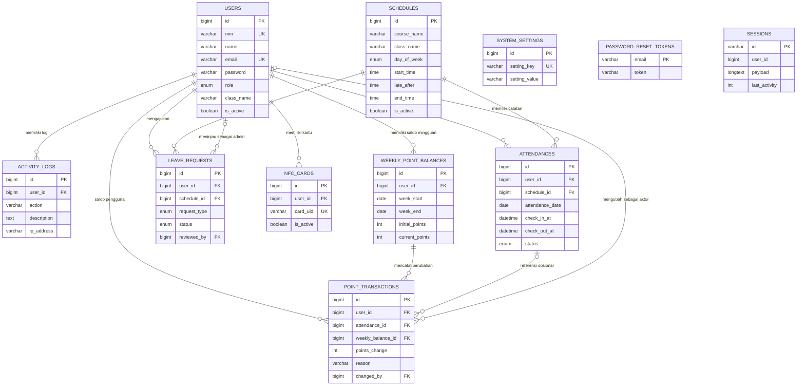

# PRD --- Presensi NFC

## Sistem Presensi Mahasiswa dengan Kartu NFC dan Poin Kedisiplinan

**Versi dokumen:** 2.0\
**Tanggal:** 25 Oktober 2026\
**Status:** Draft berdasarkan struktur folder dan dump SQL yang
diberikan\
**Platform:** Website responsif\
**Backend:** PHP Native\
**Database:** MySQL/MariaDB (`db_absensi_poin`)\
**Lingkungan pengembangan:** XAMPP pada `C:\xampp\htdocs\presensi`

---

## 1. Ringkasan Produk

Presensi NFC adalah aplikasi web untuk mendukung pengelolaan kehadiran
mahasiswa. Sistem dirancang untuk menyediakan halaman informasi publik,
autentikasi pengguna, panel administrasi, area mahasiswa, pencatatan
presensi masuk/keluar, pengelolaan jadwal, pengajuan izin/sakit,
pengelolaan kartu NFC, dan sistem poin kedisiplinan mingguan.

PRD ini dibuat dari dua sumber: 1. Struktur folder yang ditampilkan
melalui perintah `tree /F`. 2. Dump SQL database `db_absensi_poin` yang
berisi struktur tabel, indeks, foreign key, serta satu akun admin awal.

**Batasan analisis:** nama file dan struktur database dapat diketahui
dari informasi yang diberikan, tetapi isi implementasi setiap file PHP
belum diperiksa. Karena itu, fungsi file di bawah merupakan pemetaan
berdasarkan nama file dan struktur umum aplikasi; perilaku aktual harus
diverifikasi dengan membaca kode.

## 2. Tujuan Produk

- Mempermudah mahasiswa melihat jadwal dan melakukan presensi.
- Menyediakan proses login dan pemisahan hak akses admin/mahasiswa.
- Menyimpan riwayat presensi secara konsisten dan mencegah presensi
  ganda.
- Mengelola pengajuan izin dan sakit dengan persetujuan admin.
- Mengelola kartu NFC yang terdaftar pada mahasiswa.
- Menyediakan saldo poin mingguan dan histori perubahan poin.
- Membantu admin memantau aktivitas dan mengelola data secara
  terpusat.

## 3. Struktur Folder Proyek

Struktur yang diberikan:

```text
C:\xampp\htdocs\presensi
│   aturan.php
│   background.jpg
│   beranda.php
│   cara-kerja.php
│   faq.php
│   koneksi.php
│   tentang.php
│
├── admin
│   │   background.jpg
│   │   hapus-mahasiswa.php
│   │   index2.php
│   │   logout.php
│   │   mahasiswa.php
│
├── auth
│   │   background.jpg
│   │   forgot-password.php
│   │   login.php
│   │   register.php
│   │   reset-password.php
│   │   setup_admin.php
│
├── db
│   │   db_absensi_poin.sql
│
└── mahasiswa
    │   background.jpg
    │   index.php
    │   logout.php
```

### 3.1 Penjelasan file di root proyek

---

File/folder Fungsi yang diharapkan Catatan

---

`beranda.php` Halaman utama publik, Perlu verifikasi isi
pengenalan sistem, dan aktual
CTA login/registrasi

`cara-kerja.php` Penjelasan cara Perlu verifikasi isi
penggunaan presensi NFC aktual

`aturan.php` Menampilkan aturan Nilai aturan harus
presensi dan/atau poin konsisten dengan logika
kedisiplinan backend

`faq.php` Pertanyaan umum tentang Hindari menjanjikan
akun, NFC, presensi, dukungan perangkat yang
dan poin belum diuji

`tentang.php` Informasi tentang Perlu verifikasi isi
sistem atau pengelola aktual

`koneksi.php` Membuat koneksi ke Jangan menyimpan
database MariaDB/MySQL kredensial produksi di
repository publik

`background.jpg` Aset gambar untuk Periksa ukuran,
tampilan halaman publik resolusi, dan pemakaian
aktual

---

### 3.2 Folder `admin/`

---

File Fungsi yang diharapkan Akses

---

`index2.php` Dashboard admin, Admin
ringkasan statistik dan
navigasi pengelolaan

`mahasiswa.php` Menampilkan/mengelola Admin
data mahasiswa

`hapus-mahasiswa.php` Endpoint penghapusan Admin; wajib validasi
atau penonaktifan POST, CSRF, dan
mahasiswa otorisasi

`logout.php` Mengakhiri sesi admin Admin

`background.jpg` Aset visual untuk area Aset statis
admin

---

**Catatan:** belum terlihat file terpisah untuk pengelolaan jadwal,
presensi, kartu NFC, pengajuan izin/sakit, transaksi poin, log
aktivitas, atau pengaturan sistem. Fitur tersebut mungkin belum dibuat
atau mungkin digabung ke file lain; perlu diperiksa isi kode.

### 3.3 Folder `auth/`

---

File Fungsi yang diharapkan Catatan keamanan

---

`login.php` Form dan/atau proses Gunakan
autentikasi `password_verify()`,
prepared statements,
dan pembatasan
percobaan

`register.php` Registrasi mahasiswa Validasi email/NIM,
status akun, dan
kebijakan pendaftaran

`forgot-password.php` Memulai proses reset Jangan mengungkap
kata sandi apakah email terdaftar

`reset-password.php` Memvalidasi token dan Token acak,
memperbarui kata sandi kedaluwarsa, sekali
pakai, idealnya
disimpan sebagai hash

`setup_admin.php` Kemungkinan skrip **Risiko tinggi jika
inisialisasi akun admin dapat diakses publik.**
Batasi penggunaan,
hapus/nonaktifkan
setelah setup, dan
jangan izinkan membuat
admin tanpa otorisasi

`background.jpg` Aset visual halaman Aset statis
autentikasi

---

### 3.4 Folder `mahasiswa/`

File Fungsi yang diharapkan Akses

---

`index.php` Dashboard mahasiswa Mahasiswa yang login
`logout.php` Mengakhiri sesi mahasiswa Mahasiswa yang login
`background.jpg` Aset visual dashboard mahasiswa Aset statis

Belum terlihat file terpisah untuk riwayat absensi, pengajuan
izin/sakit, poin, profil, atau registrasi kartu. Periksa apakah
fitur-fitur tersebut sudah ada di `index.php` atau belum
diimplementasikan.

### 3.5 Folder `db/`

---

File Fungsi

---

`db_absensi_poin.sql` Dump SQL untuk membuat struktur
database, indeks, foreign key, dan
memasukkan akun admin awal

---

Dump SQL harus diuji pada database pengembangan sebelum digunakan untuk
instalasi baru. File dump tidak otomatis menjamin bahwa aplikasi PHP
sudah menggunakan seluruh tabel tersebut.

## 4. Aktor dan Hak Akses

### 4.1 Pengunjung

- Melihat beranda, cara kerja, aturan, FAQ, dan tentang.
- Membuka login atau registrasi sesuai kebijakan sistem.
- Tidak dapat melihat data privat mahasiswa maupun admin.

### 4.2 Mahasiswa

- Login dan logout.
- Melihat dashboard dan jadwal kuliah.
- Melakukan presensi masuk/keluar melalui metode NFC yang didukung.
- Melihat riwayat presensi dan saldo poin sendiri.
- Mengajukan izin/sakit dan memantau statusnya.
- Mengelola informasi profil sesuai kebijakan.
- Tidak boleh mengubah sendiri status presensi, keputusan pengajuan,
  atau saldo poin.

### 4.3 Admin

- Melihat dashboard dan ringkasan.
- Mengelola data mahasiswa.
- Mengelola jadwal, kartu NFC, presensi, pengajuan izin/sakit, poin,
  log aktivitas, dan pengaturan.
- Meninjau pengajuan serta melakukan koreksi yang diizinkan.
- Semua perubahan administratif harus melalui otorisasi server dan
  dicatat dalam log.

## 5. Ruang Lingkup Fitur

### MVP yang diharapkan

1.  Halaman publik.
2.  Login/logout dengan session.
3.  Registrasi mahasiswa yang aman.
4.  Dashboard admin dan mahasiswa.
5.  CRUD mahasiswa dan jadwal.
6.  Registrasi, pengaitan, dan penonaktifan kartu NFC.
7.  Presensi masuk dan keluar.
8.  Status hadir/terlambat/izin/sakit/alpha.
9.  Pengajuan izin/sakit dan persetujuan admin.
10. Saldo poin mingguan serta transaksi poin.
11. Riwayat dan rekap presensi.
12. Log aktivitas, pengaturan sistem, dan reset kata sandi.
13. Validasi input, otorisasi, dan perlindungan data.

Fitur yang belum terlihat pada struktur file tidak boleh dianggap sudah
tersedia sampai kode aktual diverifikasi.

## 6. Alur Utama Produk

### 6.1 Login

1.  Pengguna memasukkan email dan kata sandi.
2.  Server mencari akun dan memverifikasi hash kata sandi.
3.  Server memeriksa `is_active`.
4.  Server meregenerasi ID session setelah login.
5.  Pengguna diarahkan ke area sesuai `role`.
6.  Setiap halaman privat memeriksa session dan role di server.

### 6.2 Presensi masuk

1.  Mahasiswa telah login.
2.  Sistem menentukan jadwal yang sesuai atau meminta mahasiswa memilih
    jadwal yang valid.
3.  Perangkat membaca kartu NFC dan aplikasi memperoleh identifier
    kartu.
4.  Server memeriksa kartu terdaftar/aktif, kepemilikan, jadwal aktif,
    tanggal, waktu, dan presensi ganda.
5.  Sistem menyimpan `check_in_at` serta status.
6.  Sistem memberi hasil yang jelas kepada mahasiswa.

### 6.3 Presensi keluar

1.  Mahasiswa melakukan aksi presensi keluar.
2.  Sistem mencari presensi yang cocok untuk mahasiswa, jadwal, dan
    tanggal.
3.  Sistem menolak jika presensi masuk belum ada atau presensi keluar
    sudah tercatat.
4.  Sistem menyimpan `check_out_at`.

### 6.4 Pengajuan izin/sakit

1.  Mahasiswa memilih jadwal dan tanggal.
2.  Mahasiswa mengisi jenis permintaan dan alasan, lalu mengunggah
    lampiran bila diwajibkan.
3.  Sistem menyimpan status `menunggu`.
4.  Admin meninjau dan menyimpan keputusan, peninjau, waktu, dan
    catatan.
5.  Mahasiswa dapat melihat status akhirnya.

### 6.5 Poin mingguan

1.  Sistem menyediakan satu saldo per mahasiswa untuk setiap
    `week_start`.
2.  Setiap perubahan poin membuat catatan transaksi berisi nilai,
    alasan, pelaku, dan referensi saldo.
3.  Perubahan saldo dan penambahan transaksi dilakukan dalam satu
    transaksi database.
4.  Proses terjadwal yang dijalankan ulang tidak boleh menggandakan
    penalti/bonus.
5.  Mahasiswa melihat saldo dan riwayat perubahan.

**Aturan poin belum ditentukan sepenuhnya oleh skema SQL.** Saldo awal
dan saat ini default ke 100, tetapi nilai penalti/bonus, reset mingguan,
dan perlakuan izin/sakit harus disepakati sebelum logika otomatis
dibuat.

## 7. Penjelasan Database `db_absensi_poin`

Database menggunakan tabel InnoDB, tipe ID `BIGINT UNSIGNED`, dan
sebagian besar tabel menggunakan `utf8mb4_unicode_ci`.

### 7.1 Tabel `users`

**Tujuan:** menyimpan akun admin dan mahasiswa.

Kolom Arti

---

`id` Primary key akun
`nim` Nomor induk mahasiswa; boleh kosong dan unik
`name` Nama pengguna
`email` Email login; unik
`password` Hash kata sandi, bukan kata sandi teks biasa
`role` `admin` atau `mahasiswa`
`class_name` Nama kelas
`is_active` Status akun aktif/nonaktif
`email_verified_at` Waktu verifikasi email
`remember_token` Token untuk fitur remember-me bila dipakai
`created_at`, `updated_at` Waktu pembuatan/perubahan

Dump memasukkan satu akun admin awal. Pastikan kredensial awal diketahui
oleh pengelola, kata sandi diganti bila perlu, dan skrip setup admin
tidak dibiarkan terbuka.

### 7.2 Tabel `schedules`

**Tujuan:** menyimpan jadwal perkuliahan.

Kolom Arti

---

`id` Primary key jadwal
`course_name` Nama mata kuliah
`class_name` Kelas yang mengikuti jadwal
`lecturer_name` Nama dosen, opsional
`day_of_week` Hari dalam seminggu
`start_time` Waktu mulai
`late_after` Batas waktu penentuan keterlambatan
`end_time` Waktu selesai
`attendance_code` Kode presensi opsional
`is_active` Jadwal aktif/nonaktif
`created_at`, `updated_at` Timestamp

Aturan yang disarankan: `start_time <= late_after <= end_time`. Sistem
harus menetapkan zona waktu aplikasi dengan konsisten.

### 7.3 Tabel `attendances`

**Tujuan:** menyimpan satu catatan kehadiran mahasiswa per jadwal dan
tanggal.

Kolom Arti

---

`id` Primary key presensi
`user_id` Mahasiswa
`schedule_id` Jadwal
`attendance_date` Tanggal presensi
`check_in_at` Waktu masuk
`check_out_at` Waktu keluar
`status` `hadir`, `terlambat`, `izin`, `sakit`, atau `alpha`
`notes` Catatan tambahan
`created_at`, `updated_at` Timestamp

Constraint unik `(user_id, schedule_id, attendance_date)` mencegah dua
baris presensi untuk kombinasi yang sama. Aplikasi harus menangani
konflik constraint dengan aman.

### 7.4 Tabel `nfc_cards`

**Tujuan:** mengaitkan kartu NFC dengan akun mahasiswa.

Kolom Arti

---

`id` Primary key kartu
`user_id` Pemilik kartu
`card_uid` Identifier kartu, unik
`label` Nama/label kartu
`is_active` Status kartu
`registered_at` Waktu pendaftaran
`last_used_at` Waktu penggunaan terakhir
`created_at`, `updated_at` Timestamp

Kartu nonaktif atau tidak dikenal harus ditolak. UID kartu bukan jaminan
identitas yang tahan pemalsuan; risiko penyalinan UID perlu
diperhitungkan dan mitigasi tambahan mungkin dibutuhkan.

### 7.5 Tabel `leave_requests`

**Tujuan:** mengelola permohonan izin/sakit.

Kolom Arti

---

`id` Primary key permohonan
`user_id` Pemohon
`schedule_id` Jadwal yang dimohonkan
`request_date` Tanggal yang dimohonkan
`request_type` `izin` atau `sakit`
`reason` Alasan wajib
`attachment_path` Lokasi lampiran opsional
`status` `menunggu`, `disetujui`, atau `ditolak`
`reviewed_by` Admin yang meninjau
`reviewed_at` Waktu peninjauan
`review_notes` Catatan keputusan
`created_at`, `updated_at` Timestamp

Lampiran harus divalidasi ukuran dan jenisnya. Jangan mengizinkan file
unggahan dieksekusi sebagai PHP. Akses file sebaiknya dikendalikan.

### 7.6 Tabel `weekly_point_balances`

**Tujuan:** menyimpan saldo poin mahasiswa per minggu.

Kolom Arti

---

`id` Primary key saldo
`user_id` Mahasiswa pemilik saldo
`week_start` Awal periode
`week_end` Akhir periode
`initial_points` Poin awal, default 100
`current_points` Saldo saat ini, default 100
`created_at`, `updated_at` Timestamp

Constraint unik `(user_id, week_start)` memastikan satu saldo untuk
setiap mahasiswa dan awal minggu. Definisi awal/akhir minggu harus
ditetapkan, misalnya Senin--Minggu, serta konsisten di seluruh aplikasi.

### 7.7 Tabel `point_transactions`

**Tujuan:** mencatat audit setiap perubahan poin.

Kolom Arti

---

`id` Primary key transaksi
`user_id` Mahasiswa yang saldonya berubah
`attendance_id` Referensi presensi opsional
`weekly_balance_id` Saldo mingguan terkait
`points_change` Nilai perubahan; positif atau negatif
`reason` Alasan perubahan
`changed_by` Pengguna yang melakukan perubahan, opsional
`created_at` Waktu transaksi

Sebaiknya transaksi historis tidak dihapus atau diedit tanpa jejak.
Untuk mencegah pemrosesan ganda, pertimbangkan kunci idempotensi atau
constraint bisnis yang cocok dengan jenis transaksi.

### 7.8 Tabel `activity_logs`

**Tujuan:** menyimpan jejak aktivitas sistem.

Kolom Arti

---

`id` Primary key log
`user_id` Pelaku, dapat kosong
`action` Nama tindakan
`description` Detail tindakan
`ip_address` Alamat IP bila tersedia
`created_at` Waktu kejadian

Catat tindakan penting seperti login, perubahan jadwal,
penghapusan/penonaktifan akun, persetujuan izin, perubahan kartu, dan
perubahan poin. Jangan menyimpan kata sandi, token reset, atau rahasia
di log.

### 7.9 Tabel `system_settings`

**Tujuan:** menyimpan konfigurasi berbentuk key-value.

Kolom Arti

---

`id` Primary key
`setting_key` Kunci konfigurasi unik
`setting_value` Nilai konfigurasi
`description` Penjelasan
`updated_at` Waktu perubahan

Contoh konfigurasi yang mungkin disimpan: nama aplikasi, aturan
tampilan, atau parameter non-rahasia. Rahasia seperti password
database/API key tidak sebaiknya disimpan sebagai nilai biasa di tabel
ini.

### 7.10 Tabel `password_reset_tokens`

**Tujuan:** menyimpan token reset password berdasarkan email.

Kolom Arti

---

`email` Primary key email
`token` Token reset
`created_at` Waktu dibuat

Implementasi harus memastikan token acak, masa berlaku terbatas, sekali
pakai, dan idealnya disimpan sebagai hash. Email tidak boleh diberi
respons yang membocorkan apakah akun terdaftar.

### 7.11 Tabel `sessions`

**Tujuan:** menyimpan sesi pengguna di database bila aplikasi
menggunakan session handler database.

Kolom Arti

---

`id` ID sesi
`user_id` Pemilik sesi, opsional
`ip_address` IP bila tersedia
`user_agent` Informasi browser
`payload` Data sesi
`last_activity` Waktu aktivitas terakhir dalam format integer

Pastikan aplikasi benar-benar menggunakan session handler yang sesuai
dengan struktur ini. Jangan menganggap tabel ini aktif hanya karena ada
dalam dump.

## 8. ERD (Entity Relationship Diagram)

Diagram Mermaid berikut menggambarkan relasi berdasarkan foreign key
yang terdapat pada dump SQL.



### 8.1 Cara membaca ERD

- `USERS ||--o{ ATTENDANCES`: satu pengguna dapat memiliki nol atau
  banyak catatan presensi; setiap catatan presensi mengacu ke satu
  pengguna.
- `SCHEDULES ||--o{ ATTENDANCES`: satu jadwal dapat memiliki banyak
  catatan presensi.
- `USERS ||--o{ NFC_CARDS`: satu pengguna dapat memiliki beberapa
  kartu terdaftar, sesuai skema saat ini.
- `USERS ||--o{ LEAVE_REQUESTS`: satu mahasiswa dapat mengajukan
  banyak permohonan.
- Relasi `reviewed_by` menunjuk ke `USERS` sebagai admin peninjau;
  kolomnya boleh kosong sebelum ditinjau.
- `WEEKLY_POINT_BALANCES ||--o{ POINT_TRANSACTIONS`: satu saldo
  mingguan dapat memiliki banyak transaksi perubahan poin.
- `ATTENDANCES` pada `POINT_TRANSACTIONS` bersifat opsional karena
  `attendance_id` boleh `NULL`.
- `SYSTEM_SETTINGS`, `PASSWORD_RESET_TOKENS`, dan `SESSIONS` tidak
  memiliki foreign key eksplisit pada dump ini. `sessions.user_id`
  secara struktural tidak didefinisikan sebagai foreign key.

**Penting:** relasi ERD menunjukkan hubungan skema database, bukan bukti
bahwa seluruh alur aplikasi sudah diimplementasikan.

## 9. Indeks dan Constraint Penting

- `users`: primary key `id`; email unik; NIM unik namun nullable.
- `attendances`: unik `(user_id, schedule_id, attendance_date)` untuk
  mencegah presensi ganda.
- `nfc_cards`: `card_uid` unik.
- `weekly_point_balances`: unik `(user_id, week_start)`.
- `system_settings`: `setting_key` unik.
- Foreign key memastikan referensi pengguna, jadwal, saldo, dan
  transaksi valid.
- `activity_logs.user_id`, `leave_requests.reviewed_by`, serta
  `point_transactions.changed_by` memakai `ON DELETE SET NULL`.
- `nfc_cards.user_id` memakai `ON DELETE CASCADE`; penghapusan user
  akan menghapus kartu terkait. Pertimbangkan menonaktifkan akun
  daripada menghapusnya jika riwayat audit harus dipertahankan.

## 10. Aturan Bisnis yang Harus Ditetapkan

Skema database belum menjelaskan nilai aturan poin secara lengkap.
Sebelum implementasi, tetapkan:

1.  Apakah minggu berjalan Senin--Minggu atau periode lain?
2.  Apakah saldo kembali ke 100 pada awal minggu?
3.  Berapa penalti terlambat?
4.  Apakah lupa presensi keluar mengurangi poin? Berapa nilainya?
5.  Bagaimana menentukan alpha setelah mahasiswa tidak presensi masuk?
6.  Bagaimana perlakuan izin/sakit yang disetujui?
7.  Kapan presensi masuk dan keluar dibuka/ditutup?
8.  Apakah mahasiswa boleh memiliki lebih dari satu kartu aktif?
9.  Apakah kartu dibaca menggunakan HP Android, perangkat petugas, atau
    reader NFC khusus?
10. Apakah `attendance_code` digunakan untuk verifikasi tambahan?

Jangan menganggap mahasiswa alpha hanya karena belum melakukan presensi
masuk sebelum jadwal selesai. Terapkan aturan waktu dan proses
finalisasi yang jelas.

## 11. Catatan Integrasi NFC

- PHP di server tidak dapat membaca kartu NFC secara fisik tanpa
  perantara perangkat/aplikasi pembaca.
- Dukungan pembacaan NFC oleh browser bergantung pada sistem operasi,
  browser, izin, dan teknologi kartu.
- Lakukan proof of concept dengan kartu dan perangkat nyata sebelum
  menentukan arsitektur produksi.
- UID kartu dapat berisiko disalin/ditiru pada sebagian jenis kartu.
  Gunakan validasi tambahan jika risiko titip absen penting.
- Server harus memvalidasi kartu aktif, pemilik kartu, akun aktif,
  jadwal, waktu, dan duplikasi. Jangan hanya mempercayai data yang
  dikirim frontend.

## 12. Keamanan Minimum

1.  Gunakan `password_hash()` dan `password_verify()`.
2.  Gunakan PDO/MySQLi prepared statements.
3.  Terapkan CSRF token untuk operasi yang mengubah data.
4.  Escape output HTML.
5.  Periksa session dan role di setiap halaman privat dan endpoint aksi.
6.  Regenerasi session ID setelah login.
7.  Gunakan cookie `HttpOnly`, `Secure` di HTTPS, dan `SameSite` yang
    sesuai.
8.  Batasi percobaan login dan reset password.
9.  Nonaktifkan tampilan error detail pada produksi.
10. Jangan commit kredensial database, token, file `.env`, data pribadi,
    atau dump produksi ke repository publik.
11. Lindungi `auth/setup_admin.php`; hapus/nonaktifkan setelah setup
    atau batasi secara ketat.
12. Validasi file lampiran dan cegah eksekusi file di folder upload.
13. Gunakan HTTPS saat produksi.
14. Catat perubahan poin, keputusan pengajuan, dan tindakan admin.
15. Sediakan backup dan uji pemulihan.

## 13. Kebutuhan Antarmuka

### Halaman publik

- Beranda (`beranda.php`)
- Cara Kerja (`cara-kerja.php`)
- Aturan (`aturan.php`)
- FAQ (`faq.php`)
- Tentang (`tentang.php`)
- Login/registrasi

### Admin

Navigasi yang direkomendasikan: - Dashboard - Data Mahasiswa - Data
Admin (jika diizinkan) - Jadwal Kuliah - Data Absensi - Kartu NFC -
Pengajuan Izin/Sakit - Poin Kedisiplinan - Log Aktivitas - Pengaturan
Sistem - Logout

### Mahasiswa

Navigasi yang direkomendasikan: - Dashboard - Jadwal Kuliah - Presensi
NFC - Riwayat Absensi - Pengajuan Izin/Sakit - Poin Saya - Profil -
Logout

Navigasi di atas adalah rekomendasi kebutuhan produk, bukan pernyataan
bahwa seluruh halaman tersebut sudah ada dalam folder saat ini.

## 14. Kriteria Penerimaan

- Pengunjung tidak dapat membuka dashboard privat tanpa login.
- Mahasiswa tidak dapat membuka endpoint admin hanya dengan mengetik
  URL.
- Akun nonaktif tidak dapat login.
- Kartu tidak terdaftar/nonaktif ditolak.
- Kartu milik mahasiswa lain tidak dapat dipakai oleh akun yang sedang
  login.
- Satu mahasiswa tidak dapat membuat dua presensi untuk jadwal dan
  tanggal yang sama.
- Presensi keluar ditolak bila presensi masuk belum tercatat atau
  waktu keluar sudah terisi.
- Pengajuan baru memiliki status `menunggu`.
- Keputusan admin menyimpan `reviewed_by`, `reviewed_at`, dan catatan
  jika ada.
- Saldo poin konsisten dengan transaksi dan proses berulang tidak
  menggandakan penalti.
- Aksi penting menghasilkan log aktivitas yang sesuai.
- Halaman utama, login, dashboard, dan form dapat digunakan pada
  perangkat mobile.
- Tidak ada kredensial atau data pribadi sensitif di repository
  publik.

## 15. Tahapan Implementasi

### Tahap 1 --- Audit dan fondasi

- Periksa isi semua file PHP.
- Verifikasi koneksi database dan konfigurasi session.
- Pastikan autentikasi, role, CSRF, dan validasi aman.
- Cocokkan fitur yang ada dengan tabel database.

### Tahap 2 --- Master data

- Pengelolaan mahasiswa dan jadwal.
- Pengelolaan kartu NFC.
- Validasi constraint dan foreign key.

### Tahap 3 --- Presensi

- Uji pembacaan NFC pada perangkat target.
- Implementasikan masuk/keluar dan aturan waktu.
- Tambahkan pencegahan duplikasi serta penanganan error.

### Tahap 4 --- Izin dan poin

- Pengajuan izin/sakit dan tinjauan admin.
- Finalisasi aturan poin.
- Implementasikan saldo mingguan, transaksi, dan idempotensi.

### Tahap 5 --- Laporan dan rilis

- Dashboard, filter, dan rekap.
- Audit log.
- Pengujian keamanan dan responsif.
- Backup, HTTPS, konfigurasi produksi, dan dokumentasi.

## 16. Risiko dan Mitigasi

---

Risiko Mitigasi

---

UID kartu ditiru Validasi tambahan dan evaluasi
teknologi kartu

Browser tidak mendukung pembacaan Uji perangkat sasaran dan sediakan
NFC alternatif reader/aplikasi

Penalti poin ganda Transaksi database, idempotensi,
dan constraint bisnis

Aturan poin belum jelas Tetapkan kebijakan sebelum
otomatisasi

Skrip setup admin terbuka Batasi akses dan nonaktifkan
setelah setup

SQL dump berisi data akun Jangan publikasikan dump produksi;
gunakan data dummy

Penghapusan pengguna menghilangkan Pertimbangkan nonaktifkan akun dan
kartu pertahankan histori

Waktu tidak konsisten Tetapkan timezone aplikasi/server
dan uji batas tanggal

File upload berbahaya Validasi MIME/ekstensi/ukuran,
simpan di luar web root, cegah
eksekusi

---

## 17. Hal yang Belum Dapat Dipastikan

- Isi dan implementasi aktual dari setiap file PHP.
- Apakah seluruh tabel database sudah digunakan aplikasi.
- Apakah halaman admin untuk jadwal, absensi, NFC, izin, poin, log,
  dan pengaturan sudah tersedia.
- Apakah reset password sudah memakai pengiriman email dan token yang
  aman.
- Apakah registrasi publik diperbolehkan atau akun mahasiswa dibuat
  oleh admin.
- Apakah metode pembacaan NFC sudah berfungsi pada perangkat target.
- Nilai pasti penalti/bonus dan aturan reset mingguan.
- Konfigurasi produksi, hosting, HTTPS, backup, dan kebijakan retensi.

## 18. Definition of Done

Proyek dianggap siap untuk rilis ketika: - Fitur yang disepakati telah
memenuhi kriteria penerimaan. - Seluruh endpoint privat memeriksa
autentikasi dan otorisasi. - Validasi server, prepared statements, CSRF,
dan escaping telah diterapkan. - Presensi ganda dicegah di level
aplikasi dan database. - Aturan poin tertulis dan diuji. - ERD dan skema
database sesuai implementasi aktual. - Uji alur utama, keamanan,
perangkat NFC, dan responsivitas telah lulus. - Proses backup/pemulihan
telah diuji. - Kredensial dan data sensitif tidak masuk ke repository
publik. - Dokumentasi setup dan penggunaan diperbarui.

---

**Dokumen ini adalah PRD berbasis struktur folder dan dump SQL yang
dibagikan.** Untuk membuat pemetaan yang benar-benar akurat sampai
tingkat fungsi setiap file, kode sumber PHP tiap file perlu diperiksa,
karena daftar nama file saja tidak menunjukkan implementasi internalnya.
